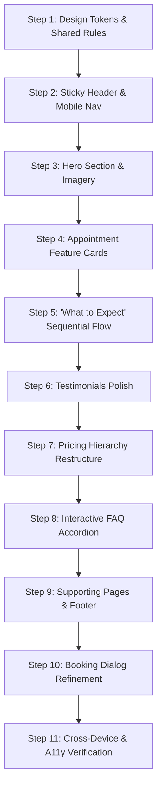

# Implementation Plan: Visuals & UX Modernization

**Document:** `Implementation.Plan.Visuals.MD`  
**Target Codebase:** Stillwell IV Studio Prototype (`stillwell-iv-studio-prototype`)  
**Status:** Reviewed & Ready for Approval (No implementation applied yet)  
**Last Updated:** 2026-10-31

---

## Executive Summary & Scope

This implementation plan establishes a cohesive, high-trust visual language and refined responsive user experience for the Stillwell IV Studio web prototype. It preserves the calm, editorial brand identity (warm cream, muted forest tones, refined serif headings) while addressing key visual shortcomings:
1. **Visual Hierarchy & Layout Spacing:** Tightening mobile vertical rhythm, eliminating awkward line wrapping, and standardizing container widths and section padding.
2. **Component Polish:** Elevating the four appointment feature cards, adding distinct sequential connectors to the "What to expect" section, and restructuring the pricing block hierarchy.
3. **Accessibility & Interactions:** Full keyboard navigation support (Escape to close menus/dialogs, roving focus), minimum 44px touch targets, clear interactive states, and smooth accordion transitions.
4. **Photography & Tone:** Replacing institutional stock images with warm studio and practitioner photography that reinforces clinical credibility and comfort.

---

## 1. What to Preserve vs. What Needs Attention

| Area | Current Observation | Recommended Direction | Target Files / Components |
| :--- | :--- | :--- | :--- |
| **Brand Identity** | Warm cream (`--ivory: #f8f7f2`), pale sage (`--sage: #e4ece5`), deep teal (`--teal: #0f4d4a`), and serif typography feel calm and distinctive. | Refine and standardize tokens across buttons, borders, and shadows. | `app/globals.css`, `components/site/brand.tsx` |
| **Hero Section** | Stock photo displays a reception counter with cool institutional blue lighting; mobile heading wraps across 4 lines at 390px. | Use warm, authentic studio photography with clear focal point; responsive typography clamp; tighter mobile spacing. | `app/page.tsx`, `lib/site-data.ts`, `app/globals.css` |
| **Feature Cards** | Repeated bordered boxes feel templated; lack clear internal rhythm and visual weight. | Equal icon sizing, subtle paper tinting, refined padding, and static informational treatment. | `app/page.tsx`, `app/globals.css` |
| **What to Expect** | Overlaps conceptually with the four feature cards; lacks visual indication of sequence. | Add sequential step connectors (horizontal line desktop, vertical timeline mobile); clarify chronological journey. | `app/page.tsx`, `app/globals.css` |
| **Pricing Hierarchy** | Price competes with policy text; booking button is separated from the core value proposition. | Make price prominent ($179); group inclusions directly beneath; soften policy panel styling. | `app/page.tsx`, `app/globals.css` |
| **FAQ Section** | Accordion only triggers on specific text clicks; lacks smooth expansion animation and strong active state. | Make entire row clickable (min 44px height); add subtle 150–200ms accordion height animation; darken active label. | `components/site/faq-list.tsx`, `app/globals.css` |
| **Booking Flow** | 3-step modal works but lacks clear selection states, disabled feedback, and scroll preservation. | Add clear fill/border to selected slots; explain disabled continue states; preserve selections on step change. | `components/site/booking-flow.tsx`, `app/globals.css` |
| **Supporting Pages** | Varying card aspect ratios and text density across Services, About, and Contact. | Standardize card aspect ratios, unify detail layouts, and improve form feedback. | `app/services/page.tsx`, `app/about/page.tsx`, `app/contact/page.tsx` |

---

## 2. Industry Inspiration & Translation

- **Next Health (IV Therapy):** Pairs editorial headlines with photography showing real clinicians and a calm studio lounge.
  - *Application:* Keep Stillwell’s split hero layout, but swap generic stock assets with imagery showcasing clinical care and peaceful studio interiors.
- **REVIV:** Compact service taxonomy, immediate booking links, and prominent medical qualification credentials.
  - *Application:* Streamline service scanning, provide direct booking buttons for individual services, and highlight practitioner oversight in the About section.

---

## 3. Step-by-Step Implementation Roadmap

---

### Step 1 — Establish Shared Design Rules & Tokens
**Target Files:** `app/globals.css`
- **Color Tokens:**
  - Base background: `--ivory: #f8f7f2`
  - Card background: `--paper: #fffefa`
  - Primary accent: `--teal: #0f4d4a` (Hover: `#0a3d3a`)
  - Accent background: `--sage: #e4ece5`
  - Border line: `--line: #d8dfd8`
  - Primary text: `--ink: #253330`
  - Secondary text: `--muted: #65716c`
- **Layout & Metrics:**
  - Standard max-width container: `width: min(1200px, calc(100% - 48px))` on desktop, `calc(100% - 32px)` on mobile.
  - Section vertical rhythm: `padding: 80px 0` to `100px 0` on desktop; `48px 0` to `64px 0` on mobile.
  - Standard button height: `48px` with `padding: 0 24px`, font-weight 600, border-radius `6px` to `8px`.
  - Standard border radius for cards, inputs, and image frames: `8px`.
- **Completion Check:** Uniform button heights, consistent border radii, and standardized container widths across all pages.

---

### Step 2 — Refine the Header & Navigation
**Target Files:** `components/site/site-header.tsx`, `components/site/brand.tsx`, `app/globals.css`
- Make header sticky with subtle bottom border and backdrop blur: `background: rgba(248, 247, 242, 0.95); backdrop-filter: blur(12px)`.
- Enlarge and adjust font-weight of "IV STUDIO" sub-brand mark for crisp legibility.
- Add active route indicator (subtle underline with `text-underline-offset: 6px` or dot indicator).
- Refactor mobile menu toggle:
  - Ensure minimum touch target of `44x44px`.
  - Add `Escape` key listener to dismiss mobile drawer and return focus to toggle trigger.
  - Order items cleanly: 4 navigation links followed by prominent "Book Appointment" CTA.
  - Prevent scroll leak when mobile menu is open.
- **Completion Check:** Header remains fixed, navigation highlights current route, mobile drawer closes via `Esc` key and preserves keyboard focus.

---

### Step 3 — Hero Section Layout & Photography
**Target Files:** `app/page.tsx`, `lib/site-data.ts`, `app/globals.css`
- Replace reception desk stock photo with warm, authentic studio photography featuring natural light and comfortable care setting.
- Tune headline typography clamp: `font-size: clamp(34px, 4.5vw, 64px)` to prevent awkward 4-line wrapping on 390px screens.
- Keep service name and price grouped together (`IV Hydration · $179`) with prototype disclaimer neatly placed underneath.
- Make "Book appointment" dominant primary button, with "Explore services" as a restrained secondary link.
- On mobile: reduce empty top spacing, crop hero image aspect ratio to 16:10 so the user reaches content without excessive scrolling.
- **Completion Check:** At 390px (iPhone viewport), headline wraps cleanly in 2-3 lines, price is immediately visible, and CTA is above the fold.

---

### Step 4 — Polish the Four Appointment Cards
**Target Files:** `app/page.tsx`, `app/globals.css`
- Ensure 4-column layout on desktop, 2-column on tablet (768px–1024px), and 1-column on mobile (<768px).
- Normalize icon containers: uniform 24px Lucide icons with consistent `1.5` stroke width.
- Refine card styling: subtle background (`var(--paper)`), thin border (`1px solid var(--line)`), no heavy box shadows, internal padding `28px 24px`.
- Balance description copy so all four cards have comparable visual height.
- Ensure cards feel clearly informational (non-clickable) to avoid misleading cursor or hover styles.
- **Completion Check:** Cards align on all breakpoints with clean vertical balance and equal heights.

---

### Step 5 — Make "What to Expect" Sequential & Distinct
**Target Files:** `app/page.tsx`, `app/globals.css`
- Clarify chronological sequence (Arrival & Assessment -> Care & Treatment -> Aftercare).
- Make step numbers (`01`, `02`, `03`) prominent using the serif font family.
- Add visual connectors:
  - Desktop: Thin horizontal rule connecting the numbers between columns.
  - Mobile: Vertical left timeline accent connecting steps sequentially.
- Keep descriptions concise, focusing on client expectations and visit duration.
- **Completion Check:** Section is clearly distinct from the 4 feature cards above it and reads as a sequential timeline.

---

### Step 6 — Refine the Testimonial Section
**Target Files:** `app/page.tsx`, `lib/site-data.ts`, `app/globals.css`
- Improve quote typography: warm serif quotation marks, balanced line height (`1.45`), and comfortable reading font size.
- Maintain clear disclosure banner: *"Illustrative testimonials — fictional examples for design preview"*.
- On mobile (<768px): Stack cards vertically with comfortable 16px gaps rather than requiring horizontal scrolling.
- **Completion Check:** Testimonials read naturally, attribution styling is subtle, and mobile view displays all cards cleanly.

---

### Step 7 — Simplify the Pricing Hierarchy
**Target Files:** `app/page.tsx`, `app/globals.css`
- Restructure the main offer card:
  - Dominant element: `$179` in large serif type with `/ visit` descriptor.
  - Immediate inclusions checklist with clean green check icons.
  - Primary booking CTA placed right below the value proposition.
- Soften the right-hand policy panel into a supportive information block rather than competing container.
- Mobile order: Price & Inclusions -> Booking Button -> Policy Terms.
- **Completion Check:** Value and pricing can be parsed in under 3 seconds; booking trigger is directly adjacent to inclusions.

---

### Step 8 — Improve FAQ Readability & Feedback
**Target Files:** `components/site/faq-list.tsx`, `app/globals.css`
- Expand clickable area: Wrap the entire row in the `<button>` element with minimum 48px height.
- Enhanced state styling:
  - Darker, bolder title when active.
  - Chevron icon rotates smoothly 180° (`transition: transform 200ms ease`).
  - Answer opens with smooth CSS transition (`grid-template-rows: 0fr -> 1fr` or subtle height transition) and respects `prefers-reduced-motion`.
- Fully accessible keyboard navigation (`Tab` + `Enter`/`Space`) and ARIA expanded state attributes.
- **Completion Check:** Clicking anywhere on the row toggles answer smoothly without jumping scroll position.

---

### Step 9 — Apply Visual Consistency to Supporting Pages
**Target Files:** `app/services/page.tsx`, `app/services/[slug]/page.tsx`, `app/about/page.tsx`, `app/contact/page.tsx`, `components/site/site-footer.tsx`
- **Services Page:** Standardize card image aspect ratios (16:10 or 4:3), align price tags, and carry selected service directly into booking dialog.
- **Service Detail Page:** Shorter introductory paragraph chunks, prominent inclusions checklist, and sticky or direct booking action.
- **About Page:** Replace generic stock photography with studio team/interior assets; highlight clinical credentials.
- **Contact Page:** Clean form layout, distinct validation error feedback (`aria-invalid="true"`, readable error colors), and actionable phone/email links.
- **Footer:** Improve secondary text contrast, organize links cleanly, and keep legal/prototype disclosures legible.
- **Completion Check:** Navigation across all pages feels like a single unified design system.

---

### Step 10 — Refine the Booking Experience
**Target Files:** `components/site/booking-flow.tsx`, `app/globals.css`
- **Step 1 (Slots):**
  - Highlight selected appointment slot with solid accent border and background.
  - Disable "Continue" button with an explanatory helper: *"Select an appointment time to continue"*.
- **Step 2 (Contact):**
  - Clear field error states for missing or malformed inputs.
  - Ensure inputs work gracefully on mobile with virtual keyboard open.
- **Step 3 (Review):**
  - Add clear summary badge (Service, Date, Time, Price).
  - Allow changing service or slot directly from review step.
- **Dialog Usability:**
  - Restrict maximum height on mobile to `calc(100vh - 32px)` with internal scrolling so "Back" and "Continue" buttons remain accessible.
  - Close on `Escape` key and outside click.
- **Completion Check:** Completing a booking flow is intuitive, selections are preserved on "Back", and validation errors are clear.

---

## 4. Responsive & Breakpoint Specifications

| Breakpoint Range | Width Range | Layout Behavior |
| :--- | :--- | :--- |
| **Small Phones** | 320px – 390px | Single-column layout; hero headline capped at 36px; stacked pricing card; compact mobile booking bar. |
| **Standard Phones** | 391px – 640px | Single column; comfortable 20px edge margins; hero image aspect ratio 16:10. |
| **Tablets** | 641px – 1024px | 2-column feature cards; 2-column service cards; header collapses to hamburger below 860px. |
| **Desktop** | > 1024px | Split hero (copy left, photo right); 4-column feature grid; 3-column process steps; 2-column pricing card. |

---

## 5. Verification & Testing Matrix

Before declaring implementation complete, verify:
- [ ] **Cross-Device Testing:** 320px (iPhone SE), 390px (iPhone 14/15), 768px (iPad Mini), 1024px (iPad Pro), 1440px (Desktop).
- [ ] **No Horizontal Overflow:** Zero horizontal scrollbars at all viewports.
- [ ] **Accessibility (WCAG 2.1 AA):**
  - Color contrast ratio ≥ 4.5:1 for body copy and ≥ 3:1 for large text.
  - Full keyboard navigation (focusable interactive elements, visible focus ring).
  - Dialog trapping and Escape key dismissal for modal and mobile drawer.
- [ ] **Performance (Core Web Vitals):**
  - Largest Contentful Paint (LCP) ≤ 2.5s.
  - Cumulative Layout Shift (CLS) ≤ 0.1 (all images have defined dimensions).
  - Interaction to Next Paint (INP) ≤ 200ms.
